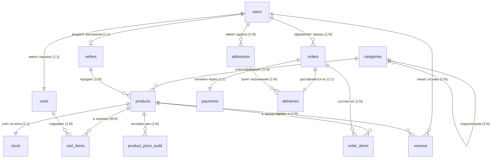

# База данных маркетплейса (PostgreSQL)


В репозитории реализован полный цикл разработки и оптимизации реляционной базы данных для платформы электронной коммерции (аналог Ozon, Wildberries): от анализа предметной области и нормализации (3НФ) до процедурного программирования на PL/pgSQL, аналитики на оконных функциях, работы с JSONB и профилирования запросов через `EXPLAIN ANALYZE`.

---

## 📑 Содержание

1. [Быстрый старт (Развёртывание)](#1-быстрый-старт-развёртывание)
2. [Структура репозитория и навигация по лабораторным](#2-структура-репозитория-и-навигация-по-лабораторным)
3. [Архитектура предметной области и ER-диаграмма](#3-архитектура-предметной-области-и-er-диаграмма)
4. [Словарь данных (Data Dictionary)](#4-словарь-данных-data-dictionary)
5. [Серверная логика и целостность (PL/pgSQL)](#5-серверная-логика-и-целостность-plpgsql)
6. [Аналитические витрины и отчёты (CTE, Window Functions)](#6-аналитические-витрины-и-отчёты-cte-window-functions)
7. [Оптимизация производительности и индексы](#7-оптимизация-производительности-и-индексы)

---

## 1. Быстрый старт (Развёртывание)

Все финальные воспроизводимые скрипты для развёртывания базы «под ключ» собраны в каталоге [lab07/](lab07/). 

Для создания схемы, наполнения данными и компиляции логики выполните скрипты по порядку:

```bash
# 1. Создание схемы в 3НФ (14 таблиц, все ограничения и каскадные правила)
psql -U postgres -d marketplace -f lab07/01_schema.sql

# 2. Наполнение базы согласованными данными (100 пользователей, 1002 товара, 1000 заказов)
psql -U postgres -d marketplace -f lab07/02_seed.sql

# 3. Компиляция серверной логики (функции place_order, get_seller_revenue, триггеры)
psql -U postgres -d marketplace -f lab07/03_logic.sql

# 4. Создание аналитических витрин (VIEW) и выполнение ключевых отчётов
psql -U postgres -d marketplace -f lab07/04_views_and_reports.sql

# 5. Применение продакшен-индексов (B-tree и GIN)
psql -U postgres -d marketplace -f lab07/05_indexes.sql
```

*(Также можно последовательно выполнить файлы в PyCharm, DataGrip или DBeaver).*

---

## 2. Структура репозитория и навигация по лабораторным

| Раздел | Тема работы | Основные технологии и результаты | README                           |
|---|---|---|----------------------------------|
| **[lab01/](lab01/)** | Проектирование и DDL | Реляционная модель, 3НФ, `IDENTITY`, `CHECK`, `RESTRICT`/`CASCADE` | [README_1.md](lab01/README_1.md) |
| **[lab02/](lab02/)** | Базовые SQL-запросы | Наполнение через `generate_series`, фильтры `WHERE`, `LIKE`, пагинация `LIMIT/OFFSET` | [README_2.md](lab02/README_2.md) |
| **[lab03/](lab03/)** | Многотабличные запросы | Соединения (`INNER`, `LEFT`, `ANTI JOIN`), подзапросы (`IN`, `EXISTS`), витрины `VIEW` | [README_3.md](lab03/README_3.md) |
| **[lab04/](lab04/)** | Оконные функции | Ранжирование (`DENSE_RANK`), нарастающий итог `SUM() OVER ()`, тренды `LAG`/`LEAD` | [README_4.md](lab04/README_4.md) |
| **[lab05/](lab05/)** | Транзакции и PL/pgSQL | ACID, `place_order` с `FOR UPDATE`, аудит цен, триггер автопересчёта рейтинга | [README_5.md](lab05/README_5.md) |
| **[lab06/](lab06/)** | JSONB и Оптимизация | Слабоструктурированные атрибуты, B-tree и GIN индексы, профилирование `EXPLAIN ANALYZE` | [README_6.md](lab06/README_6.md) |
| **[lab07/](lab07/)** | Итоговый проект | Единый релизный пакет DDL, согласованный сид, серверная логика и документация | [README_7.md](lab07/README_7.md) |

---

## 3. Архитектура предметной области и ER-диаграмма

### Концептуальная ER-диаграмма



### Принципы нормализации (3НФ)
1. **1НФ (Атомарность):** все скалярные атрибуты неделимы. Динамические характеристики товаров хранятся в формате `JSONB`, не создавая разреженных мусорных колонок в реляционной таблице.
2. **2НФ (Полная функциональная зависимость):** таблицы связей `cart_items` и `order_items` содержат составные первичные ключи (`cart_id, product_id`), а зависимые поля (`quantity`, `unit_price`) зависят от всего составного ключа целиком.
3. **3НФ (Отсутствие транзитивных зависимостей):** 
   - Адреса вынесены в сущность `addresses`, исключая дублирование города и улицы в каждом заказе.
   - Историческая цена покупки фиксируется в `order_items.unit_price`, гарантируя неизменность истории заказов при изменении текущей цены в `products.price`.
   - Данные продавца вынесены в таблицу `sellers`.

---

## 4. Словарь данных (Data Dictionary)

В базе данных выделено **14 сущностей**, полностью описывающих процессы торговли, складского учёта, доставки и аудита:

<details>
<summary><b>Развернуть полный словарь данных по всем 14 таблицам</b></summary>

### 1. `users` (Учётные записи)
| Столбец | Тип | Ограничения | Назначение |
|---|---|---|---|
| `id` | `BIGINT` | `PK, IDENTITY` | Суррогатный первичный ключ пользователя |
| `full_name` | `TEXT` | `NOT NULL` | Фамилия и имя |
| `email` | `TEXT` | `NOT NULL, UNIQUE` | Уникальный email для авторизации |
| `role` | `TEXT` | `CHECK (buyer, seller, admin)` | Роль учётной записи в системе |
| `created_at` | `TIMESTAMPTZ`| `DEFAULT now()` | Дата и время регистрации |

### 2. `sellers` (Магазины продавцов)
| Столбец | Тип | Ограничения | Назначение |
|---|---|---|---|
| `id` | `BIGINT` | `PK, IDENTITY` | Первичный ключ магазина |
| `user_id` | `BIGINT` | `UNIQUE, FK -> users(id)` | Владелец магазина (`ON DELETE RESTRICT`) |
| `store_name` | `TEXT` | `NOT NULL, UNIQUE` | Публичное название магазина |
| `is_verified`| `BOOLEAN`| `DEFAULT false` | Отметка о прохождении проверки юрлица |
| `created_at` | `TIMESTAMPTZ`| `DEFAULT now()` | Дата открытия магазина |

### 3. `categories` (Классификатор каталога)
| Столбец | Тип | Ограничения | Назначение |
|---|---|---|---|
| `id` | `BIGINT` | `PK, IDENTITY` | Первичный ключ категории |
| `parent_id` | `BIGINT` | `FK -> categories(id)` | Родительская категория (самоссылка) |
| `name` | `TEXT` | `NOT NULL, UNIQUE` | Название категории |
| *CHECK* | — | `parent_id <> id` | Запрет прямой рекурсии категории на саму себя |

### 4. `products` (Каталог товаров)
| Столбец | Тип | Ограничения | Назначение |
|---|---|---|---|
| `id` | `BIGINT` | `PK, IDENTITY` | Первичный ключ товара |
| `seller_id` | `BIGINT` | `NOT NULL, FK -> sellers` | Продавец (`RESTRICT`) |
| `category_id`| `BIGINT` | `NOT NULL, FK -> categories` | Категория (`RESTRICT`) |
| `title` | `TEXT` | `NOT NULL` | Наименование товара |
| `description`| `TEXT` | `NULLABLE` | Текстовое описание |
| `price` | `NUMERIC(12,2)` | `CHECK (price > 0)` | Текущая цена |
| `is_active` | `BOOLEAN` | `DEFAULT true` | Флаг активности в каталоге |
| `attributes` | `JSONB` | `NULLABLE` | Характеристики (бренд, диагональ, RAM, цвет) |
| `rating` | `NUMERIC(3,2)` | `CHECK (1.00..5.00)` | Денормализованный средний рейтинг (триггер) |
| `created_at` | `TIMESTAMPTZ`| `DEFAULT now()` | Дата публикации товара |

### 5. `stock` (Складские остатки)
| Столбец | Тип | Ограничения | Назначение |
|---|---|---|---|
| `product_id` | `BIGINT` | `PK, FK -> products(id)` | Товар (`ON DELETE CASCADE`) |
| `quantity` | `INTEGER` | `CHECK (quantity >= 0)` | Доступный физический остаток на складе |
| `updated_at` | `TIMESTAMPTZ`| `DEFAULT now()` | Время последнего изменения остатка |

### 6. `carts` (Корзины покупателей)
| Столбец | Тип | Ограничения | Назначение |
|---|---|---|---|
| `id` | `BIGINT` | `PK, IDENTITY` | Первичный ключ корзины |
| `user_id` | `BIGINT` | `UNIQUE, FK -> users` | Владелец (`ON DELETE CASCADE`) |
| `created_at` | `TIMESTAMPTZ`| `DEFAULT now()` | Время создания корзины |

### 7. `cart_items` (Позиции в корзине)
| Столбец | Тип | Ограничения | Назначение |
|---|---|---|---|
| `cart_id` | `BIGINT` | `PK, FK -> carts` | Корзина (`ON DELETE CASCADE`) |
| `product_id` | `BIGINT` | `PK, FK -> products` | Добавленный товар (`ON DELETE CASCADE`) |
| `quantity` | `INTEGER` | `CHECK (quantity > 0)` | Выбранное количество |

### 8. `addresses` (Адреса доставки)
| Столбец | Тип | Ограничения | Назначение |
|---|---|---|---|
| `id` | `BIGINT` | `PK, IDENTITY` | Идентификатор адреса |
| `user_id` | `BIGINT` | `NOT NULL, FK -> users` | Покупатель (`ON DELETE CASCADE`) |
| `city` | `TEXT` | `NOT NULL` | Город |
| `street` | `TEXT` | `NOT NULL` | Улица |
| `house` | `TEXT` | `NOT NULL` | Дом / строение |
| `is_default` | `BOOLEAN` | `DEFAULT false` | Основной адрес доставки |
| `created_at` | `TIMESTAMPTZ`| `DEFAULT now()` | Время добавления |

### 9. `orders` (Заказы)
| Столбец | Тип | Ограничения | Назначение |
|---|---|---|---|
| `id` | `BIGINT` | `PK, IDENTITY` | Номер заказа |
| `user_id` | `BIGINT` | `NOT NULL, FK -> users` | Покупатель (`RESTRICT`) |
| `status` | `TEXT` | `CHECK (new, paid, delivering, completed, cancelled)` | Статус выполнения заказа |
| `total_amount`| `NUMERIC(12,2)`| `CHECK (total_amount >= 0)` | Итоговая сумма заказа |
| `created_at` | `TIMESTAMPTZ`| `DEFAULT now()` | Время оформления |

### 10. `order_items` (Позиции заказа)
| Столбец | Тип | Ограничения | Назначение |
|---|---|---|---|
| `id` | `BIGINT` | `PK, IDENTITY` | Номер строки позиции |
| `order_id` | `BIGINT` | `NOT NULL, FK -> orders` | Заказ (`ON DELETE CASCADE`) |
| `product_id` | `BIGINT` | `NOT NULL, FK -> products` | Купленный товар (`RESTRICT`) |
| `quantity` | `INTEGER` | `CHECK (quantity > 0)` | Количество единиц |
| `unit_price` | `NUMERIC(12,2)`| `CHECK (unit_price > 0)` | Историческая цена покупки за единицу |
| *UNIQUE* | — | `(order_id, product_id)`| Запрет повторения товара в одном заказе |

### 11. `payments` (Платежи)
| Столбец | Тип | Ограничения | Назначение |
|---|---|---|---|
| `id` | `BIGINT` | `PK, IDENTITY` | Идентификатор платежа |
| `order_id` | `BIGINT` | `UNIQUE, FK -> orders` | Заказ (`RESTRICT`) |
| `amount` | `NUMERIC(12,2)`| `CHECK (amount > 0)` | Сумма оплаты |
| `status` | `TEXT` | `CHECK (pending, completed, failed)` | Статус эквайринга |
| `paid_at` | `TIMESTAMPTZ`| `NULLABLE` | Время подтверждения оплаты банком |

### 12. `reviews` (Отзывы)
| Столбец | Тип | Ограничения | Назначение |
|---|---|---|---|
| `id` | `BIGINT` | `PK, IDENTITY` | Идентификатор отзыва |
| `user_id` | `BIGINT` | `NOT NULL, FK -> users` | Автор (`RESTRICT`) |
| `product_id` | `BIGINT` | `NOT NULL, FK -> products` | Товар (`ON DELETE CASCADE`) |
| `score` | `INTEGER` | `CHECK (score BETWEEN 1 AND 5)`| Оценка (1..5) |
| `comment` | `TEXT` | `NULLABLE` | Текст отзыва |
| `created_at` | `TIMESTAMPTZ`| `DEFAULT now()` | Время публикации |
| *UNIQUE* | — | `(user_id, product_id)`| Запрет повторных отзывов от одного юзера |

### 13. `deliveries` (Служба доставки)
| Столбец | Тип | Ограничения | Назначение |
|---|---|---|---|
| `id` | `BIGINT` | `PK, IDENTITY` | Номер доставки |
| `order_id` | `BIGINT` | `UNIQUE, FK -> orders` | Заказ (`RESTRICT`) |
| `address_id` | `BIGINT` | `NOT NULL, FK -> addresses` | Адрес вручения (`RESTRICT`) |
| `delivery_status`| `TEXT` | `CHECK (processing, in_transit, delivered, failed)` | Логистический статус |
| `tracking_code`| `TEXT` | `NULLABLE` | Трек-номер посылки |
| `shipped_at` | `TIMESTAMPTZ`| `NULLABLE` | Время отправки |
| `delivered_at`| `TIMESTAMPTZ`| `NULLABLE` | Время вручения покупателю |

### 14. `product_price_audit` (Аудит цен)
| Столбец | Тип | Ограничения | Назначение |
|---|---|---|---|
| `id` | `BIGINT` | `PK, IDENTITY` | Идентификатор записи аудита |
| `product_id` | `BIGINT` | `NOT NULL` | ID товара, изменившего цену |
| `old_price` | `NUMERIC(12,2)`| `NOT NULL` | Цена до изменения |
| `new_price` | `NUMERIC(12,2)`| `NOT NULL` | Новая цена |
| `changed_at` | `TIMESTAMPTZ`| `DEFAULT now()` | Точное время изменения |
| `changed_by` | `TEXT` | `DEFAULT CURRENT_USER` | Пользователь БД, выполнивший `UPDATE` |

</details>

---

## 5. Серверная логика и целостность (PL/pgSQL)

В каталоге [lab07/03_logic.sql](lab07/03_logic.sql) реализованы критические бизнес-процессы:

### 1. Атомарное оформление заказа (`place_order`)
- **Защита от состояния гонки (Race Condition):** запрос остатка использует блокировку `FOR UPDATE`, предотвращая одновременную продажу одного и того же остатка двум покупателям.
- **Транзакционность (ACID):** вставка в `orders`, добавление позиций в `order_items` и уменьшение `stock.quantity` выполняются в единой транзакции. При нехватке товара `RAISE EXCEPTION` откатывает всю операцию.

### 2. Расчёт чистой выручки (`get_seller_revenue`)
- Вычисляет фактическую выручку магазина за заданный период (`start_date` .. `end_date`), отсекая отменённые заказы (`status <> 'cancelled'`).

### 3. Автоматический аудит истории цен (`trg_audit_product_price`)
- Триггер `AFTER UPDATE OF price ON products` гарантирует, что любое изменение цены логируется в `product_price_audit` без участия бэкенда.

### 4. Денормализация среднего рейтинга (`trg_refresh_product_rating`)
- Триггер `AFTER INSERT OR UPDATE OF score OR DELETE ON reviews` пересчитывает средний балл товара и записывает его в `products.rating`. Устраняет необходимость тяжёлой агрегации `AVG(score)` при каждом просмотре каталога.

---

## 6. Аналитические витрины и отчёты (CTE, Window Functions)

В каталоге [lab07/04_views_and_reports.sql](lab07/04_views_and_reports.sql) реализованы типовые сценарии аналитики:

1. **Аналитические витрины (VIEW):**
   - `v_product_catalog` — скрывает за собой 3 `JOIN`, предоставляя плоскую витрину каталога.
   - `v_category_product_stats` — витрина агрегированной статистики по категориям.
   - `v_daily_sales` — предвычисленные ежедневные финансовые показатели.
2. **Рекурсивное дерево категорий (`WITH RECURSIVE`):**
   - Обходит иерархию классификатора неограниченной глубины с расчётом уровня вложенности (`depth`).
3. **Оконные функции:**
   - **`DENSE_RANK()`:** выборка топ-3 самых дорогих товаров в каждой категории без пропусков рангов.
   - **`SUM() OVER (ORDER BY day)`:** расчёт накопительного итога (Running Total) выручки по дням.
   - **`LAG()` / `LEAD()`:** расчёт ежедневного темпа прироста выручки маркетплейса день-ко-дню.
   - **`SUM() OVER (PARTITION BY category_id)`:** долевой анализ (процент рынка, занимаемый каждым продавцом внутри категории).

---

## 7. Оптимизация производительности и индексы

В каталоге [lab07/05_indexes.sql](lab07/05_indexes.sql) сформирован сбалансированный набор продакшен-индексов:

### 1. Архитектура индексов
- **B-tree на `products(price)`:** ускоряет фильтры цен и обеспечивает бесплатную сортировку (**Zero-cost sort**) в обратном порядке (`Index Scan Backward`), устраняя операцию `Sort: quicksort`.
- **B-tree на внешние ключи (`category_id`, `seller_id`, `user_id`, `product_id`):** ликвидируют последовательные сканирования при соединениях `JOIN` и выборках в личном кабинете.
- **GIN на `products(attributes)`:** инвертированный индекс разбирает JSONB на атомарные пары «ключ-значение». Обеспечивает мгновенный поиск по вхождению (`@>`) и наличию ключей (`?`) через побитовое пересечение битовых карт (`Bitmap Index Scan`).

### 2. Экспериментальное подтверждение цены индексов (Бенчмарк)
В ходе теста массовой вставки **100 000 строк** ([lab06/lab06_06_insert_benchmark.sql](lab06/lab06_06_insert_benchmark.sql)):
- Время вставки в таблицу **без индексов:** `~140–180 мс`.
- Время вставки в таблицу **с 2 индексами:** `~540–600 мс` (**в ~3.5 раза медленнее**).
- **Вывод:** каждый индекс замедляет операции записи (`INSERT/UPDATE/DELETE`), поэтому индексы должны размещаться строго на критических путях чтения данных.
