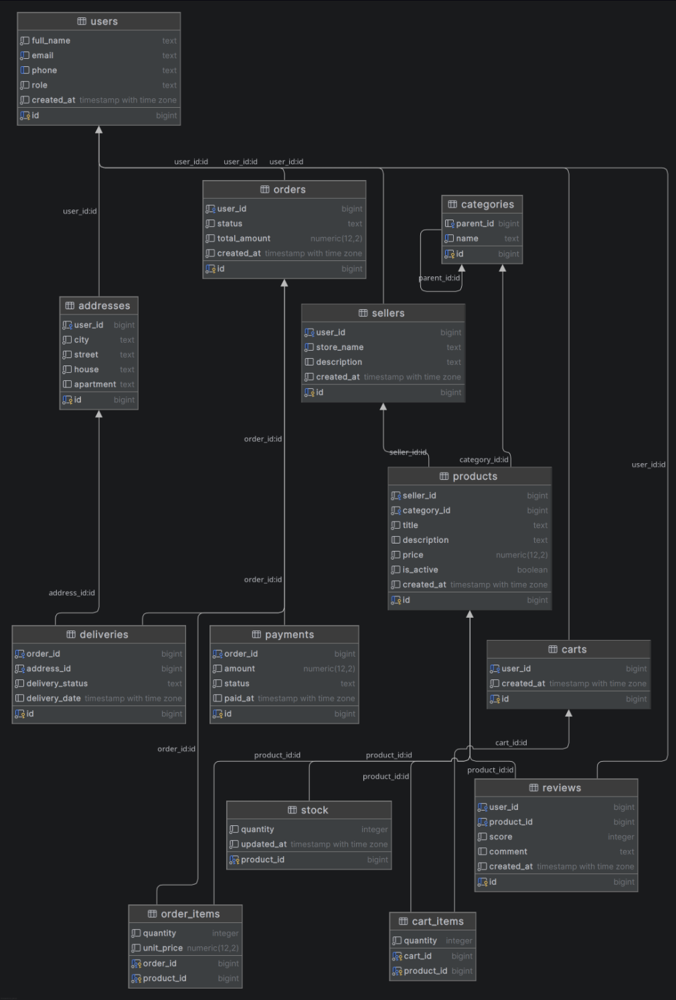

## 1. Создание базы

## 2. Бизнес-правила
1. Пользователь может быть покупателем и (опционально) владельцем одного магазина-продавца (1 : 0..1).
2. Email пользователя уникален; телефон, если указан, уникален.
3. Название магазина уникально.
4. У товара ровно один продавец и ровно одна категория; цена товара строго больше 0.
5. Категория может иметь родительскую категорию; корневые категории имеют `parent_id = NULL`; категория не может быть родителем самой себя.
6. Для товара ведётся один складской остаток (1 : 1); остаток не может быть отрицательным.
7. У пользователя не более одной корзины; один товар встречается в корзине не более одного раза, количество > 0.
8. Заказ принадлежит ровно одному покупателю и содержит хотя бы одну позицию.
9. Один товар встречается в заказе не более одного раза (PK `order_id, product_id`); в позиции фиксируется цена на момент покупки.
10. У заказа не более одного платежа и не более одной доставки.
11. Платёж со статусом `paid` обязан иметь дату оплаты.
12. Отзыв оставляется конкретным пользователем конкретному товару; один пользователь — один отзыв на товар; оценка от 1 до 5.
13. Доставка осуществляется по адресу, принадлежащему пользователю.
14. Нельзя удалить товар, который есть в оформленных заказах, и пользователя, у которого есть заказы.

## 3. ER-диаграмма

Сущности (13): users, sellers, categories, products, stock, carts, cart_items, addresses, orders, order_items, payments, reviews, deliveries.

| Вид связи | Где реализован |
|---|---|
| 1 : N | sellers → products, categories → products, users → orders, orders → order_items |
| 1 : 0..1 | users → sellers, users → carts, orders → payments, orders → deliveries |
| 1 : 1 | products → stock |
| M : N (ассоц. таблица) | orders ↔ products через `order_items`; carts ↔ products через `cart_items` |
| Иерархия (самоссылка) | `categories.parent_id → categories.id` |

## 4. Нормализация (до 3НФ)

### Исходная (ненормализованная) таблица

`orders_flat(order_id, order_date, user_id, user_name, user_email, product_id, product_title, category_name, seller_name, quantity, unit_price)`, первичный ключ — (`order_id`, `product_id`).

Пример данных:

| order_id | order_date | user_id | user_name | user_email | product_id | product_title | category_name | seller_name | quantity | unit_price |
|---|---|---|---|---|---|---|---|---|---|---|
| 1 | 2026-03-10 | 10 | Иванов И. | ivan@mail.ru | 100 | Чайник | Бытовая техника | ТехМир | 1 | 500.00 |
| 1 | 2026-03-10 | 10 | Иванов И. | ivan@mail.ru | 101 | Кружка | Посуда | ДомУют | 2 | 120.00 |
| 2 | 2026-10-01 | 10 | Иванов И. | ivan@mail.ru | 100 | Чайник | Бытовая техника | ТехМир | 1 | 700.00 |

### Функциональные зависимости

- `order_id` → `order_date`, `user_id` (дата и покупатель определяются заказом);
- `user_id` → `user_name`, `user_email` (данные пользователя определяются пользователем);
- `product_id` → `product_title`, `category_name`, `seller_name` (данные товара определяются товаром);
- (`order_id`, `product_id`) → `quantity`, `unit_price` (количество и цена на момент покупки зависят от пары «заказ + товар»; в примере у товара 100 цена в разных заказах разная: 500.00 и 700.00).

### Аномалии

- **Вставки:** нельзя добавить новый товар в каталог, пока его никто не заказал: часть первичного ключа (`order_id`) окажется пустой.
- **Обновления:** смена email Иванова требует правки во всех его строках (в примере их три); пропуск одной приводит к рассогласованию данных (у одного пользователя два разных email).
- **Удаления:** при удалении единственного заказа с товаром 101 (заказ 1) теряются сведения о самом товаре, его категории и продавце.

### Приведение к нормальным формам

**1НФ.** Все значения атомарны: в ячейках нет списков и повторяющихся групп. Условие выполнено.

**2НФ.** Требуется, чтобы каждый неключевой атрибут зависел от всего составного ключа (`order_id`, `product_id`), а не от его части. Нарушения:
- `order_date`, `user_id`, `user_name`, `user_email` зависят только от `order_id`;
- `product_title`, `category_name`, `seller_name` зависят только от `product_id`.

Это частичные зависимости. Выносим их: данные заказа в таблицу `orders`, данные товара в таблицу `products`. В `order_items` остаются только `quantity` и `unit_price`, которые зависят от всей пары ключей.

**3НФ.** Требуется отсутствие транзитивных зависимостей (неключевой атрибут не зависит от другого неключевого). Нарушения:
- `user_name`, `user_email` зависят от `user_id`, а тот зависит от `order_id` (`order_id` → `user_id` → `user_name`). Выносим в таблицу `users`;
- `seller_name` зависит от продавца, а продавец определяется товаром (`product_id` → `seller_id` → `seller_name`). Выносим в таблицу `sellers`;
- `category_name` зависит от категории, а категория определяется товаром (`product_id` → `category_id` → `category_name`). Выносим в таблицу `categories`.

### Результат

| Таблица | Содержимое | Ключ |
|---|---|---|
| `users` | `user_name`, `user_email` и др. данные пользователя | `id` |
| `sellers` | `store_name` (бывший `seller_name`), владелец | `id` |
| `categories` | `name` (бывший `category_name`), родитель | `id` |
| `products` | `title`, цена, ссылки `seller_id`, `category_id` | `id` |
| `orders` | дата, статус, ссылка `user_id` | `id` |
| `order_items` | `quantity`, `unit_price` | (`order_id`, `product_id`) |

Все аномалии устранены:
- вставка: товар хранится в `products` независимо от заказов;
- обновление: email хранится в одной строке `users`, правится один раз;
- удаление: удаление заказа убирает только его позиции, сведения о товаре, категории и продавце сохраняются.

### Осознанная денормализация

- `orders.total_amount` — вычисляемая сумма заказа. Она выводится из `order_items`, но хранится для ускорения выборок и отчётов. Платой за это становится риск аномалии обновления (сумма может разойтись с позициями). Формально таблица `orders` остаётся в 3НФ, так как избыточность межтабличная.
- `order_items.unit_price` денормализацией не является: это снимок цены на момент покупки. Цена товара в каталоге меняется, а стоимость уже оформленного заказа должна оставаться прежней. Поэтому `unit_price` зависит от всей пары (`order_id`, `product_id`), как показано в зависимостях выше.

## 5. Выбор ключей
Во всех таблицах с самостоятельной сущностью — суррогатный ключ `BIGINT GENERATED ALWAYS AS IDENTITY`: он стабилен, компактен и не зависит от бизнес-правил (email или телефон могут измениться). Естественные кандидаты (`email`, `store_name`, `categories.name`) сохранены как альтернативные ключи через `UNIQUE`.

| Таблица | PK | Обоснование |
|---|---|---|
| users, sellers, categories, products, carts, addresses, orders, payments, reviews, deliveries | `id` (суррогатный) | стабильность, компактность |
| stock | `product_id` | связь 1:1, ключ совпадает с внешним ключом |
| cart_items | (`cart_id`, `product_id`) | ассоциативная таблица, составной естественный ключ исключает дубли |
| order_items | (`order_id`, `product_id`) | то же |

## 6. Правила ON DELETE / ON UPDATE
- **RESTRICT** — для данных, которые нельзя потерять молча: товары в заказах, продавец с товарами, пользователь с заказами, платежи, категория с товарами/потомками, адрес с доставкой.
- **CASCADE** — для «зависимых частей»: позиции заказа/корзины, корзина и адреса пользователя, остаток и отзывы товара, доставка заказа.
- **ON UPDATE CASCADE** — на всех внешних ключах (ключи-идентификаторы не меняются, но правило задано явно по ТЗ).

## 7. Словарь данных

### users — пользователи
| Столбец | Тип | Ограничения | Назначение |
|---|---|---|---|
| id | BIGINT | PK, identity | Идентификатор |
| full_name | TEXT | NOT NULL | ФИО |
| email | TEXT | NOT NULL, UNIQUE, CHECK формат | Email, логин |
| phone | TEXT | UNIQUE | Телефон |
| role | TEXT | NOT NULL, DEFAULT 'buyer', CHECK (buyer/seller/admin) | Роль |
| created_at | TIMESTAMPTZ | NOT NULL, DEFAULT now() | Дата регистрации |

### sellers — продавцы
| Столбец | Тип | Ограничения | Назначение |
|---|---|---|---|
| id | BIGINT | PK, identity | Идентификатор |
| user_id | BIGINT | NOT NULL, UNIQUE, FK → users, RESTRICT | Владелец |
| store_name | TEXT | NOT NULL, UNIQUE | Название магазина |
| description | TEXT | — | Описание |
| created_at | TIMESTAMPTZ | NOT NULL, DEFAULT now() | Дата создания |

### categories — категории
| Столбец | Тип | Ограничения | Назначение |
|---|---|---|---|
| id | BIGINT | PK, identity | Идентификатор |
| parent_id | BIGINT | FK → categories, RESTRICT, CHECK ≠ id | Родитель (NULL для корня) |
| name | TEXT | NOT NULL, UNIQUE | Название |

### products — товары
| Столбец | Тип | Ограничения | Назначение |
|---|---|---|---|
| id | BIGINT | PK, identity | Идентификатор |
| seller_id | BIGINT | NOT NULL, FK → sellers, RESTRICT | Продавец |
| category_id | BIGINT | NOT NULL, FK → categories, RESTRICT | Категория |
| title | TEXT | NOT NULL | Наименование |
| description | TEXT | — | Описание |
| price | NUMERIC(12,2) | NOT NULL, CHECK > 0 | Цена |
| is_active | BOOLEAN | NOT NULL, DEFAULT TRUE | Доступен для продажи |
| created_at | TIMESTAMPTZ | NOT NULL, DEFAULT now() | Дата добавления |

### stock — остатки
| Столбец | Тип | Ограничения | Назначение |
|---|---|---|---|
| product_id | BIGINT | PK, FK → products, CASCADE | Товар |
| quantity | INTEGER | NOT NULL, DEFAULT 0, CHECK ≥ 0 | Количество на складе |
| updated_at | TIMESTAMPTZ | NOT NULL, DEFAULT now() | Время обновления |

### carts — корзины
| Столбец | Тип | Ограничения | Назначение |
|---|---|---|---|
| id | BIGINT | PK, identity | Идентификатор |
| user_id | BIGINT | NOT NULL, UNIQUE, FK → users, CASCADE | Владелец |
| created_at | TIMESTAMPTZ | NOT NULL, DEFAULT now() | Дата создания |

### cart_items — позиции корзины
| Столбец | Тип | Ограничения | Назначение |
|---|---|---|---|
| cart_id | BIGINT | PK (часть), FK → carts, CASCADE | Корзина |
| product_id | BIGINT | PK (часть), FK → products, CASCADE | Товар |
| quantity | INTEGER | NOT NULL, DEFAULT 1, CHECK > 0 | Количество |

### addresses — адреса
| Столбец | Тип | Ограничения | Назначение |
|---|---|---|---|
| id | BIGINT | PK, identity | Идентификатор |
| user_id | BIGINT | NOT NULL, FK → users, CASCADE | Владелец адреса |
| city | TEXT | NOT NULL | Город |
| street | TEXT | NOT NULL | Улица |
| house | TEXT | NOT NULL | Дом |
| apartment | TEXT | — | Квартира |

### orders — заказы
| Столбец | Тип | Ограничения | Назначение |
|---|---|---|---|
| id | BIGINT | PK, identity | Идентификатор |
| user_id | BIGINT | NOT NULL, FK → users, RESTRICT | Покупатель |
| status | TEXT | NOT NULL, DEFAULT 'new', CHECK (new/paid/shipped/delivered/cancelled) | Статус |
| total_amount | NUMERIC(12,2) | NOT NULL, DEFAULT 0, CHECK ≥ 0 | Сумма заказа (денормализация) |
| created_at | TIMESTAMPTZ | NOT NULL, DEFAULT now() | Дата оформления |

### order_items — позиции заказа
| Столбец | Тип | Ограничения | Назначение |
|---|---|---|---|
| order_id | BIGINT | PK (часть), FK → orders, CASCADE | Заказ |
| product_id | BIGINT | PK (часть), FK → products, RESTRICT | Товар |
| quantity | INTEGER | NOT NULL, CHECK > 0 | Количество |
| unit_price | NUMERIC(12,2) | NOT NULL, CHECK > 0 | Цена на момент покупки |

### payments — платежи
| Столбец | Тип | Ограничения | Назначение |
|---|---|---|---|
| id | BIGINT | PK, identity | Идентификатор |
| order_id | BIGINT | NOT NULL, UNIQUE, FK → orders, RESTRICT | Оплачиваемый заказ |
| amount | NUMERIC(12,2) | NOT NULL, CHECK > 0 | Сумма |
| status | TEXT | NOT NULL, DEFAULT 'pending', CHECK (pending/paid/failed/refunded) | Статус |
| paid_at | TIMESTAMPTZ | CHECK: при 'paid' не NULL | Время оплаты |

### reviews — отзывы
| Столбец | Тип | Ограничения | Назначение |
|---|---|---|---|
| id | BIGINT | PK, identity | Идентификатор |
| user_id | BIGINT | NOT NULL, FK → users, CASCADE | Автор |
| product_id | BIGINT | NOT NULL, FK → products, CASCADE | Товар |
| score | INTEGER | NOT NULL, CHECK 1..5 | Оценка |
| comment | TEXT | — | Комментарий |
| created_at | TIMESTAMPTZ | NOT NULL, DEFAULT now() | Дата |
| | | UNIQUE (user_id, product_id) | Один отзыв на товар |

### deliveries — доставки
| Столбец | Тип | Ограничения | Назначение |
|---|---|---|---|
| id | BIGINT | PK, identity | Идентификатор |
| order_id | BIGINT | NOT NULL, UNIQUE, FK → orders, CASCADE | Заказ |
| address_id | BIGINT | NOT NULL, FK → addresses, RESTRICT | Адрес доставки |
| delivery_status | TEXT | NOT NULL, DEFAULT 'processing', CHECK (processing/in_transit/delivered/returned) | Статус |
| delivery_date | TIMESTAMPTZ | — | Дата доставки |
