## Файлы

| Файл | Назначение |
|---|---|
| [lab1.sql](../lab01/lab1.sql) | Создание структуры базы из первой лабораторной |
| [lab02_seed.sql](lab02_seed.sql) | Наполнение всех 13 таблиц тестовыми данными |
| [lab02_queries.sql](lab02_queries.sql) | Восемь запросов на выборку |
| [images/](images/) | Скриншоты результатов |

## 1. Порядок запуска

1. Подключиться к учебной базе PostgreSQL, например `marketplace`, через SQL-клиент.
2. В пустой учебной базе создать структуру с помощью `lab01/lab1.sql`.
3. Один раз выполнить `lab02/lab02_seed.sql`.
4. Запускать запросы из `lab02/lab02_queries.sql` по отдельности и просматривать результаты.

> **Важно:** `lab1.sql` удаляет существующие таблицы и данные. Не запускать его в заполненной базе без намерения пересоздать её. Повторная вставка через `lab02_seed.sql` не предусмотрена. Генератор рассчитан на исходные идентификаторы после создания схемы; случайные цены при пересоздании изменятся.

## 2. Наполнение таблиц

| Таблица | Количество строк |
|---|---:|
| users | 100 |
| sellers | 10 |
| categories | 5 |
| products | 1000 |
| stock | 1000 |
| carts | 100 |
| cart_items | 200 |
| addresses | 100 |
| orders | 1000 |
| order_items | 1000 |
| payments | 1000 |
| reviews | 100 |
| deliveries | 1000 |

## 3. Пользователи, магазины и категории

Созданы 10 пользователей-продавцов и 90 покупателей, 10 магазинов и 5 категорий. «Телефоны» и «Ноутбуки» являются дочерними для «Электроники». Для наполнения использован `generate_series`, строки сформированы оператором конкатенации `||`.

```sql
-- Продавцы
INSERT INTO users (full_name, email, role)
SELECT
    'Продавец ' || g,
    'seller' || g || '@example.com',
    'seller'
FROM generate_series(1, 10) g;

-- Покупатели
INSERT INTO users (full_name, email, role)
SELECT
    'Покупатель ' || g,
    'buyer' || g || '@example.com',
    'buyer'
FROM generate_series(1, 90) g;

-- Магазины пользователей-продавцов
INSERT INTO sellers (user_id, store_name)
SELECT id, 'Магазин ' || id
FROM users
WHERE role = 'seller';

-- Корневые категории
INSERT INTO categories (name)
VALUES ('Электроника'), ('Книги'), ('Одежда');

-- Дочерние категории
INSERT INTO categories (parent_id, name)
SELECT id, 'Телефоны'
FROM categories
WHERE name = 'Электроника';

INSERT INTO categories (parent_id, name)
SELECT id, 'Ноутбуки'
FROM categories
WHERE name = 'Электроника';
```

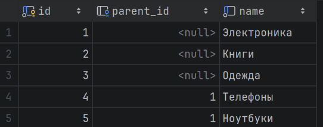

*Рисунок 1 — Иерархия категорий.*

## 4. Товары и складские остатки

Добавлены 500 телефонов и 500 ноутбуков. Цены сформированы `random()` и приведены к `numeric(12,2)`. У телефонов описание `NULL`, у ноутбуков заполнено. Выражение `g <= 450` создаёт по 450 активных и 50 неактивных товаров каждой группы: всего 900 активных и 100 неактивных. Для каждого товара создан остаток 20 единиц.

```sql
-- 500 телефонов без описания, последние 50 неактивны
INSERT INTO products (
    seller_id, category_id, title, price, is_active
)
SELECT
    1,
    4,
    'Телефон №' || g,
    (random() * 49000 + 1000)::numeric(12,2),
    g <= 450
FROM generate_series(1, 500) AS g;

-- 500 ноутбуков с описанием, последние 50 неактивны
INSERT INTO products (
    seller_id, category_id, title, description, price, is_active
)
SELECT
    2,
    5,
    'Ноутбук №' || g,
    'Описание ноутбука №' || g,
    (random() * 90000 + 10000)::numeric(12,2),
    g <= 450
FROM generate_series(1, 500) AS g;

-- Остатки для всех товаров
INSERT INTO stock (product_id, quantity)
SELECT id, 20
FROM products;
```

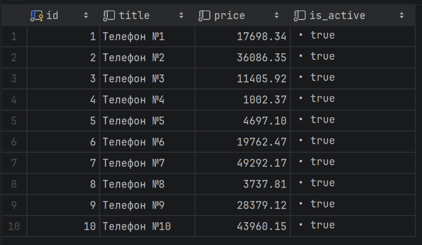

*Рисунок 2 — Фрагмент таблицы товаров.*

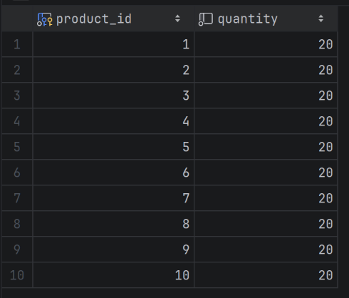

*Рисунок 3 — Фрагмент складских остатков.*

## 5. Корзины и адреса

Созданы 100 корзин и 100 адресов — по одному на пользователя. В каждую корзину добавлены товары №1 и №2 в количестве 1 и 2 соответственно; всего 200 позиций. Квартира не указана и имеет значение `NULL`.

```sql
-- Корзины всех пользователей
INSERT INTO carts (user_id)
SELECT id
FROM users;

-- Первый товар в каждой корзине
INSERT INTO cart_items (cart_id, product_id, quantity)
SELECT id, 1, 1
FROM carts;

-- Второй товар в каждой корзине
INSERT INTO cart_items (cart_id, product_id, quantity)
SELECT id, 2, 2
FROM carts;

-- Адреса всех пользователей
INSERT INTO addresses (user_id, city, street, house)
SELECT
    id,
    'Москва',
    'Учебная улица',
    'Дом ' || id
FROM users;
```

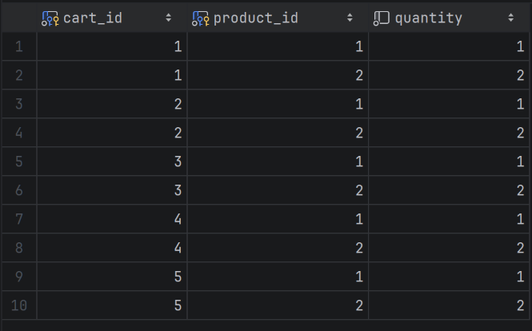

*Рисунок 4 — Позиции корзин.*

## 6. Заказы, позиции и платежи

Создано 1000 заказов со статусом `new` — по 10 на пользователя. Выражение `(g - 1) % 100 + 1` циклически формирует существующие `user_id` от 1 до 100. В каждом заказе одна единица товара №1 по фиксированной цене покупки 17698.34 руб. Сумма заказа явно задана и совпадает со стоимостью позиции и суммой платежа. Все 1000 платежей имеют статус `pending`, `paid_at` — `NULL`.

```sql
-- 1000 заказов, по 10 на пользователя
INSERT INTO orders (user_id, status, total_amount)
SELECT
    (g - 1) % 100 + 1,
    'new',
    17698.34
FROM generate_series(1, 1000) AS g;

-- Одна позиция в каждом заказе
INSERT INTO order_items (
    order_id, product_id, quantity, unit_price
)
SELECT
    id,
    1,
    1,
    total_amount
FROM orders;

-- Платежи в ожидании оплаты
INSERT INTO payments (order_id, amount, status)
SELECT
    id,
    total_amount,
    'pending'
FROM orders;
```

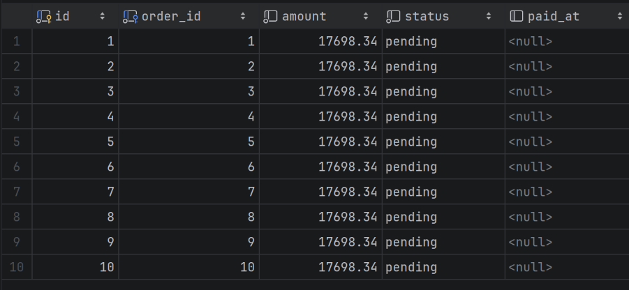

*Рисунок 5 — Платежи по заказам.*

## 7. Отзывы и доставки

Добавлены 100 отзывов: каждый пользователь один раз оценивает товар №1. Выражение `(id - 1) % 5 + 1` формирует оценки 1–5. Создано 1000 доставок со статусом `processing` без даты доставки. В наборе `addresses.id` совпадает с `addresses.user_id`, поэтому `orders.user_id` используется как `address_id`.

```sql
-- По одному отзыву от каждого пользователя
INSERT INTO reviews (user_id, product_id, score, comment)
SELECT
    id,
    1,
    (id - 1) % 5 + 1,
    'Тестовый отзыв пользователя №' || id
FROM users;

-- Доставки заказов
INSERT INTO deliveries (order_id, address_id, delivery_status)
SELECT
    id,
    user_id,
    'processing'
FROM orders;
```

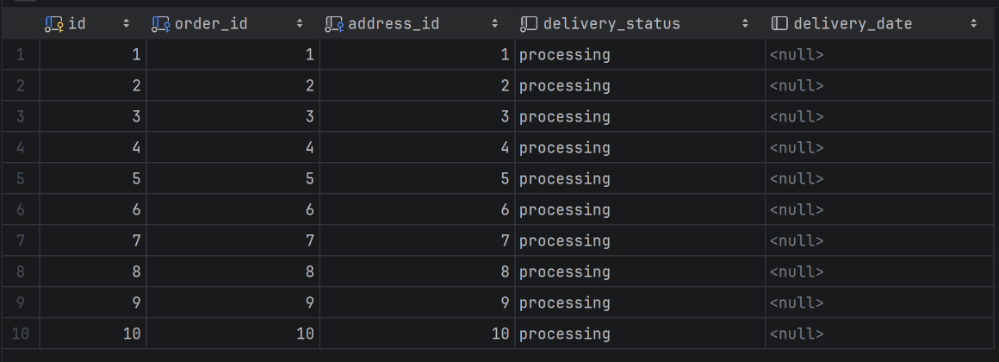

*Рисунок 6 — Доставки заказов.*

## 8. Выборка уникальных значений и псевдонимы

**Назначение:** получить различные сочетания категории и активности товаров. `DISTINCT` устраняет повторения по обоим выбранным полям. `category_number` и `available` — псевдонимы столбцов результата.

```sql
SELECT DISTINCT
    category_id category_number,
    is_active available
FROM products
ORDER BY category_number, available;
```

**Фактический результат:** 4 строки.

| category_number | available |
|---:|---|
| 4 | f |
| 4 | t |
| 5 | f |
| 5 | t |

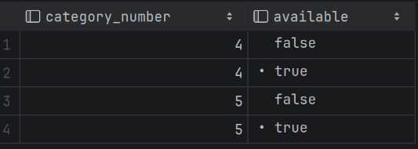

*Рисунок 7 — Уникальные категории и активность.*

## 9. Составные условия AND и OR

**Назначение:** выбрать активные телефоны не дороже 20000 руб. и активные ноутбуки не дороже 40000 руб. Внешние скобки распространяют проверку активности на обе альтернативы.

```sql
SELECT id, title, category_id, price, is_active
FROM products
WHERE is_active = TRUE
  AND (
      (category_id = 4 AND price <= 20000)
      OR
      (category_id = 5 AND price <= 40000)
  )
ORDER BY id;
```

**Фактический результат:** 341 строка.

| id | title | category_id | price | is_active |
|---:|---|---:|---:|---|
| 1 | Телефон №1 | 4 | 17698.34 | t |
| 3 | Телефон №3 | 4 | 11405.92 | t |
| 4 | Телефон №4 | 4 | 1002.37 | t |
| 5 | Телефон №5 | 4 | 4697.10 | t |
| 6 | Телефон №6 | 4 | 19762.47 | t |

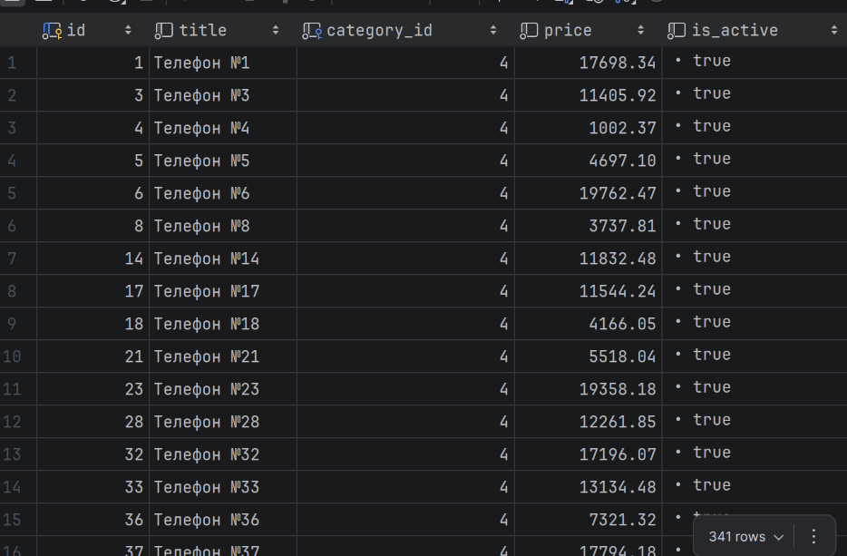

*Рисунок 8 — Составная фильтрация товаров.*

## 10. Фильтрация диапазона цен: BETWEEN

**Назначение:** выбрать товары по цене от 10000 до 20000 руб. включительно. `BETWEEN` включает обе границы диапазона.

```sql
SELECT id, title, price
FROM products
WHERE price BETWEEN 10000 AND 20000
ORDER BY id;
```

**Фактический результат:** 175 строк.

| id | title | price |
|---:|---|---:|
| 1 | Телефон №1 | 17698.34 |
| 3 | Телефон №3 | 11405.92 |
| 6 | Телефон №6 | 19762.47 |
| 14 | Телефон №14 | 11832.48 |
| 17 | Телефон №17 | 11544.24 |

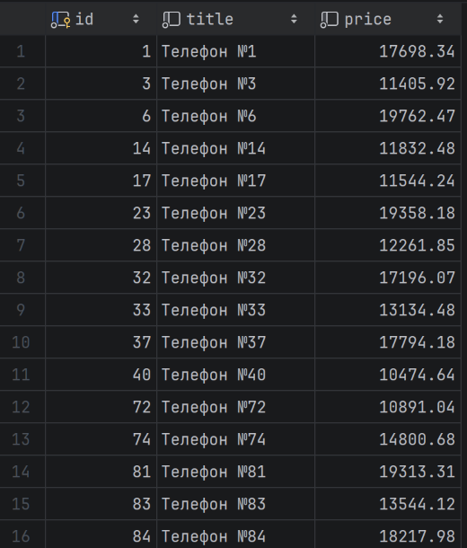

*Рисунок 9 — Товары в диапазоне цен.*

## 11. Фильтрация по списку категорий: IN

**Назначение:** выбрать товары с `category_id` из списка 4 и 5. В текущем наборе все товары принадлежат этим двум категориям, поэтому выборка возвращает весь каталог.

```sql
SELECT id, title, category_id
FROM products
WHERE category_id IN (4, 5)
ORDER BY id;
```

**Фактический результат:** 1000 строк.

| id | title | category_id |
|---:|---|---:|
| 1 | Телефон №1 | 4 |
| 2 | Телефон №2 | 4 |
| 3 | Телефон №3 | 4 |
| 4 | Телефон №4 | 4 |
| 5 | Телефон №5 | 4 |

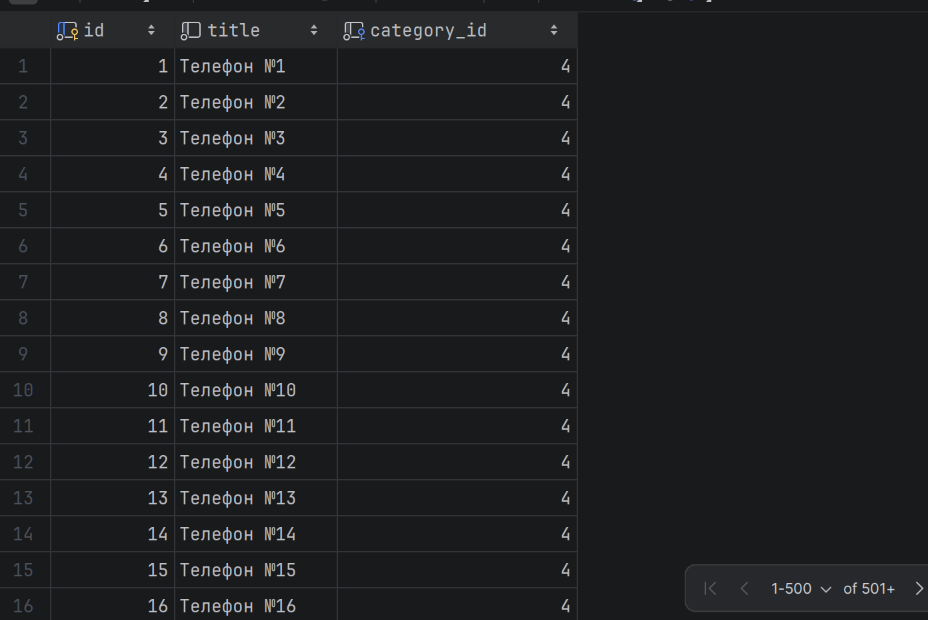

*Рисунок 10 — Товары выбранных категорий.*

## 12. Поиск по шаблону и проверка NULL

**Назначение:** найти товары, название которых содержит «телефон» без учёта регистра, а описание отсутствует. Проценты в шаблоне обозначают произвольный текст до и после искомой последовательности. `IS NULL` проверяет отсутствие значения, а не пустую строку.

```sql
SELECT id, title, description
FROM products
WHERE title ILIKE '%телефон%'
  AND description IS NULL
ORDER BY id;
```

**Фактический результат:** 500 строк.

| id | title | description |
|---:|---|---|
| 1 | Телефон №1 | NULL |
| 2 | Телефон №2 | NULL |
| 3 | Телефон №3 | NULL |
| 4 | Телефон №4 | NULL |
| 5 | Телефон №5 | NULL |

> В исходном PDF рисунок 11 повторяет скриншот запроса IN (рисунок 10): на нём показан category_id вместо description. Здесь приведён текстовый результат без неподходящей иллюстрации. Номера остальных рисунков сохранены.

## 13. Сортировка по двум столбцам

**Назначение:** вывести товары по цене по убыванию; при одинаковой цене упорядочить их по названию по возрастанию. Второй ключ применяется только при равенстве первого.

```sql
SELECT id, title, price
FROM products
ORDER BY price DESC, title ASC;
```

**Фактический результат:** 1000 строк.

| id | title | price |
|---:|---|---:|
| 935 | Ноутбук №435 | 99857.04 |
| 533 | Ноутбук №33 | 99836.94 |
| 640 | Ноутбук №140 | 99775.40 |
| 514 | Ноутбук №14 | 99678.43 |
| 949 | Ноутбук №449 | 99410.34 |

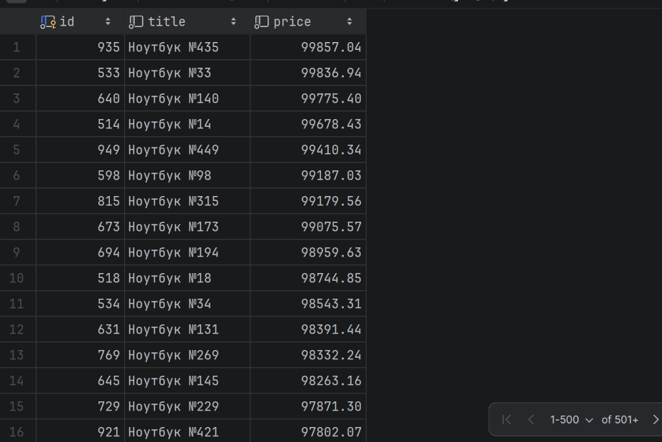

*Рисунок 12 — Сортировка товаров.*

## 14. Постраничный вывод: первая страница

**Назначение:** вывести первые 20 строк упорядоченного каталога. `OFFSET 0` не пропускает строки. `ORDER BY` по уникальному `id` задаёт однозначный порядок.

```sql
SELECT id, title, price
FROM products
ORDER BY id
LIMIT 20 OFFSET 0;
```

**Фактический результат:** 20 строк.

| id | title | price |
|---:|---|---:|
| 1 | Телефон №1 | 17698.34 |
| 2 | Телефон №2 | 36086.35 |
| 3 | Телефон №3 | 11405.92 |
| 4 | Телефон №4 | 1002.37 |
| 5 | Телефон №5 | 4697.10 |

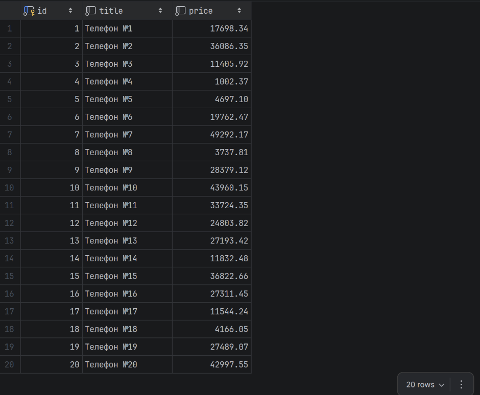

*Рисунок 13 — Первая страница каталога.*

## 15. Постраничный вывод: вторая страница

**Назначение:** пропустить первые 20 строк и вернуть следующие 20. Это позиции 21–40 в результате, а не общее правило о значениях `id`. При неизменных данных две страницы не пересекаются.

```sql
SELECT id, title, price
FROM products
ORDER BY id
LIMIT 20 OFFSET 20;
```

**Фактический результат:** 20 строк.

| id | title | price |
|---:|---|---:|
| 21 | Телефон №21 | 5518.04 |
| 22 | Телефон №22 | 26287.87 |
| 23 | Телефон №23 | 19358.18 |
| 24 | Телефон №24 | 38074.50 |
| 25 | Телефон №25 | 34627.60 |

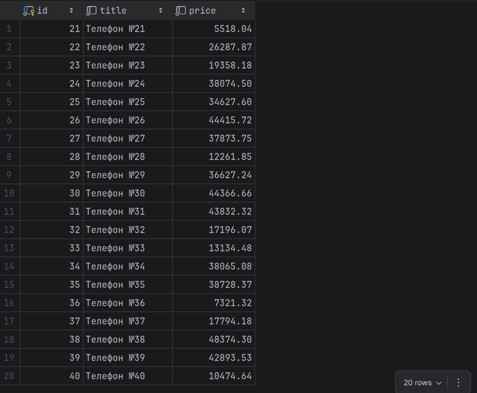

*Рисунок 14 — Вторая страница каталога.*